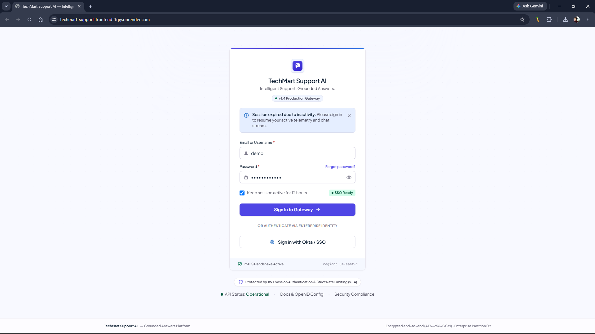
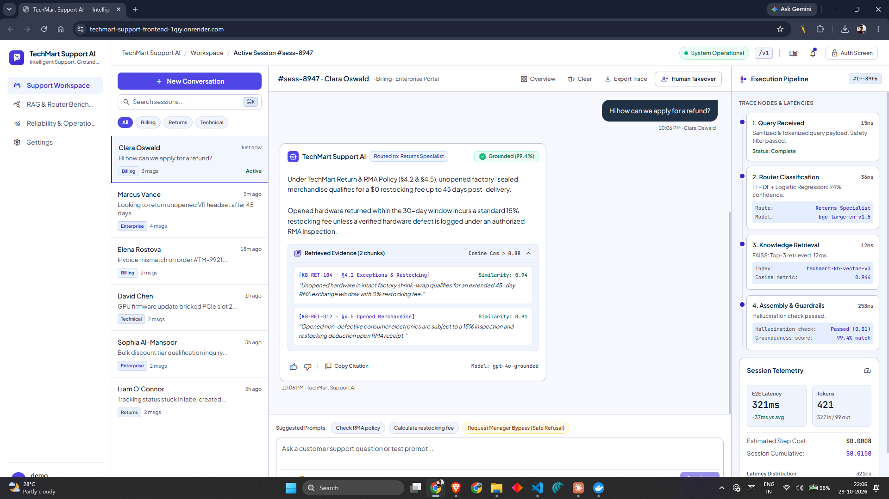
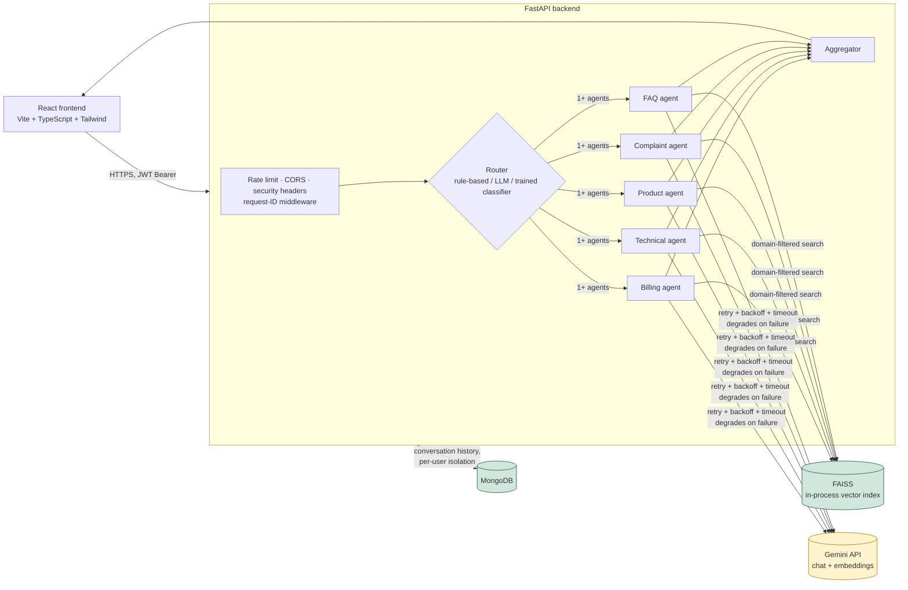

# TechMart Support — Multi-Agent RAG Customer Support System

[](https://github.com/VivekRupapara146/Techmart_Support_AI/actions/workflows/ci.yml)

A multi-agent, RAG-grounded customer support system for a fictional
electronics retailer — built to demonstrate real architectural
decision-making (routing strategy tradeoffs, grounding/refusal behavior,
reliability under failure, measured evaluation) rather than just wiring an
LLM to a chat box.

> 🌐 **Live Demo:** [https://techmart-support-frontend-1qiy.onrender.com/](https://techmart-support-frontend-1qiy.onrender.com/)  
> 🎬 **Video Walkthrough (2:28 min):** [Watch the Full Walkthrough on YouTube](https://youtu.be/10hscH7IV8M)

---
## UI & System Walkthrough

[-red?style=for-the-badge&logo=youtube)](https://youtu.be/10hscH7IV8M)

| Login Screen | Support Workspace & Grounded Evidence |
| :---: | :---: |
|  |  |

## Architecture



Two API generations are mounted side by side: a versioned, camelCase
`/v1/*` contract (what the frontend speaks, with real per-step telemetry)
and the original unprefixed routes (kept for backward compatibility with
the test suite). Both run through the same `core/chat_pipeline.py` so they
can never drift apart in behavior — see
[`backend/README.md`](backend/README.md) for the full endpoint list.

## Structure

```
.
├── backend/              FastAPI + RAG pipeline + 3 interchangeable routers
├── frontend/              React + TypeScript + Tailwind (Vite)
├── docs/screenshots/     Visual assets and interface screenshots
├── docker-compose.yml     API + local MongoDB, one command
├── render.yaml             Render Blueprint (fallback deploy target)
├── DEPLOYMENT.md           AWS App Runner (primary) + Render (fallback) + local Docker
└── .github/workflows/      CI (tests + Docker build) and AWS deploy
```

Each half has its own README: [`backend/README.md`](backend/README.md) ·
[`frontend/README.md`](frontend/README.md)

## Quick start (local)

```bash
cp .env.docker.example .env.docker   # fill in GEMINI_API_KEY at minimum
docker compose up --build            # API + Mongo
```
```bash
cd frontend && npm install
echo "VITE_API_BASE_URL=http://localhost:8000/v1" > .env.local
npm run dev
```
See [`backend/README.md`](backend/README.md) for running the backend
without Docker, and for `scripts/run_dev_server_with_fakes.py` — the real
app with a mocked LLM/Mongo, for poking at the API with zero credentials.

## What makes this more than a chat wrapper

- **3 interchangeable routers** behind one interface: rule-based keyword
  matching, an LLM-based structured-output classifier, and a Banking77-
  trained TF-IDF + Logistic Regression classifier — built specifically to
  support a measured three-way comparison (table below), swappable per
  request via `/v1/chat`'s optional `router` field.
- **RAG grounding with an honesty guarantee**: retrieval confidence below
  threshold triggers an explicit "I don't know" rather than letting the
  LLM improvise — measured directly in the retrieval evaluation (below),
  not just asserted.
- **Multi-agent aggregation**: a single query can span multiple
  specialists (e.g. a billing issue that's also a technical one); responses
  and their evidence/telemetry are merged, not single-routed.
- **Reliability, not just a happy path**: Gemini calls get a timeout,
  bounded retries with exponential backoff, and degrade to an honest
  "temporarily unavailable" message instead of a 500 — with a second,
  provider-agnostic safety net at the agent layer. Every request carries a
  correlation ID through logs and the `X-Request-ID` response header.
- **Real telemetry, not decoration**: `/v1/chat` reports actual retrieved
  evidence with real similarity scores, actual Gemini token counts and a
  derived cost estimate, actual per-step latency, and a real running
  session cost — no fabricated numbers standing in for metrics the system
  doesn't actually compute.
- **Security built in from the start**: JWT auth, rate limiting, CORS,
  security headers, prompt-injection mitigation (tested), and a startup
  guard that refuses to boot in production with placeholder secrets.
- **Domain-filtered retrieval**: each agent only searches its own mapped
  knowledge base documents (billing can never retrieve product content),
  with one deliberate, disclosed overlap (Premium subscription content
  spans billing and technical).
- **Conversation history**: past conversations are listed and reloadable,
  backed by MongoDB with per-user ownership isolation.
- **CI**: every push runs the full test suite and a Docker build via
  GitHub Actions — fully offline, no live credentials needed in CI.
  Deploys to AWS App Runner on manual trigger via OIDC (no stored AWS
  keys).

## Evaluation

### Router comparison
Evaluated on 30 hand-labeled TechMart queries (single-domain, multi-domain,
messy phrasing, ambiguous). *Hit rate* = at least one predicted agent is
correct; *exact match* = predicted set equals the expected set.

| Router | Hit rate | Exact match | Avg latency | Marginal cost |
|---|---|---|---|---|
| v1 — Rule-based (default) | 73.3% | 40.0% | 0.01 ms | none (local) |
| v2 — LLM-based (Gemini) | 86.7% | 50.0% | 478 ms | 1 LLM call / query |
| v2b — TF-IDF + LR (Banking77) | 30.0% | 10.0% | 84 ms | none (local) |

The LLM router is the most accurate; rule-based is the default because it's
free and instant. 30 queries is a small set — treat differences as
directional, not statistically conclusive. Full per-category breakdown and
disclosed limitations:
[`backend/eval/router_comparison_report.md`](backend/eval/router_comparison_report.md).
Served live at `GET /v1/evaluation/summary`.

### Retrieval quality (hit@k, MRR, groundedness, refusal correctness)
A 75-case labeled set (58 in-KB questions across all 6 knowledge-base
documents + 17 deliberately out-of-KB questions) measures FAISS retrieval
directly — not just router accuracy. See
[`backend/eval/retrieval_eval.py`](backend/eval/retrieval_eval.py)'s
docstring for exact metric definitions (including what "groundedness" does
and doesn't claim — no LLM-hallucination judge, a stricter retrieval-based
proxy instead).

Numbers aren't committed yet — this requires a real `GEMINI_API_KEY` (the
build environment had no outbound access to Gemini's API, see
`scripts/run_retrieval_evaluation.py`'s docstring). Run it yourself:
```bash
cd backend && python -m scripts.run_retrieval_evaluation
```
and the real hit@1/hit@3/hit@5/MRR@5/groundedness/refusal numbers will
appear here and at `GET /v1/evaluation/summary`.

### Load testing
Real, committed p50/p95/p99 latency numbers (and an honest explanation of
what they do and don't measure):
[`backend/loadtest/README.md`](backend/loadtest/README.md).

## Deployment

See [`DEPLOYMENT.md`](DEPLOYMENT.md): AWS App Runner (primary target, with
real cost disclosed), Render (active deployment target), and local Docker Compose.

## Tests

92 checks across 15 files, all offline (mocked Mongo, fake LLM/embedding
providers — no real credentials needed). Runs automatically on every push
via `.github/workflows/ci.yml`, which also builds the Docker image.
See [`backend/README.md`](backend/README.md) for running them locally.

## Scope note

This is a portfolio/resume project demonstrating production-adjacent
engineering practices (reliability, evaluation, CI/CD, containerization,
cloud deployment) at a scale appropriate for a single demo deployment —
not a commercial product. Known, disclosed scaling boundaries (in-process
FAISS, single demo credential, per-worker rate limiting) are documented in
[`DEPLOYMENT.md`](DEPLOYMENT.md) rather than hidden.
